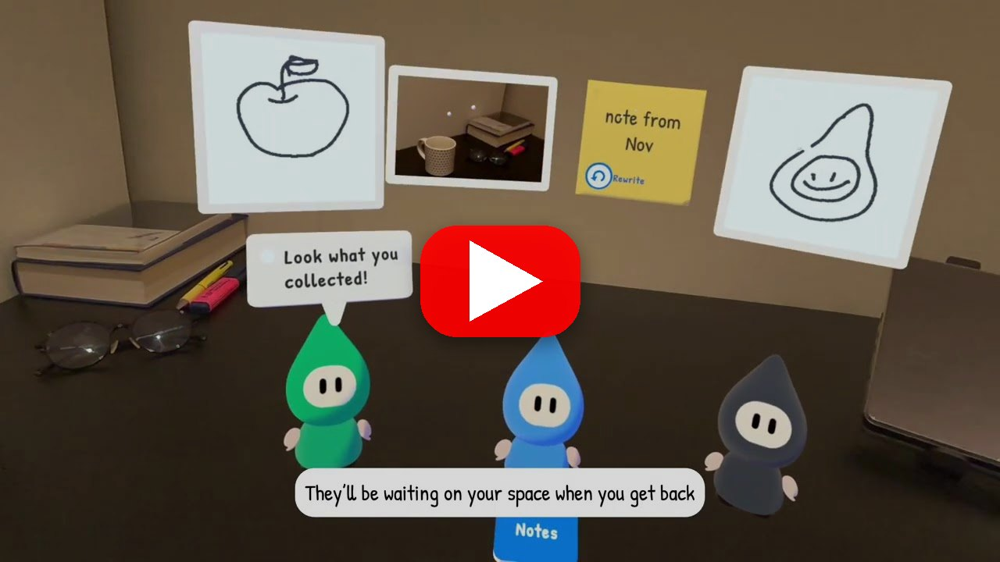
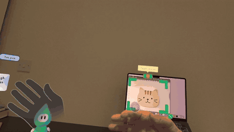
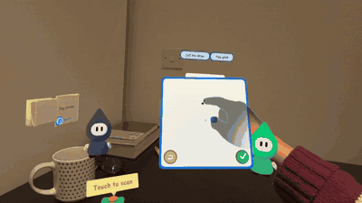
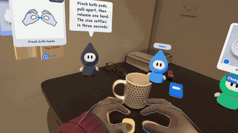
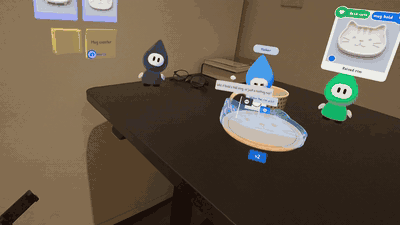
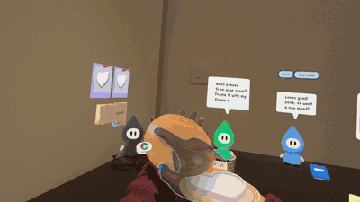

# Roomsmiths VR

<h3 align="center"><a href="https://roomsmiths.pages.dev">Website</a> &nbsp;·&nbsp; <a href="https://youtu.be/gkSY7PJxXm4">Demo video</a></h3>

**A controller-free mixed reality workshop where three tiny AI companions help you brainstorm, design and
create personalised 3D objects for your own space.**

Built in Unity for Meta Quest 3 and 3S.

## Overview

Good ideas often come from brainstorming with others, and turning an idea into a real object usually means
gathering references, taking measurements and learning 3D modelling. Roomsmiths VR puts a small creative
team on your desk instead: Spark, Maker and Fixer think with you, design with you and help you make
something that actually fits your room, from the first "what if?" to downloadable 3D files.

## Meet the crew

| | Role | Tools |
|---|---|---|
| **Spark** | The explorer. Finds inspiration in your room and gathers references. | Magnifier, capture frame, colour palette |
| **Maker** | The designer and lead. Sketches, carves and paints your object. | Sketchbook, carving tools, brush, notebook |
| **Fixer** | The engineer. Makes sure it fits and can be printed. | Tape measure, size box, print check |

## Features

### Discover inspiration
Clap to summon the crew. Share an idea, or ask Spark to explore your surroundings: the crew suggests
possibilities and places sticky notes beside the real objects that inspired them.

### Develop the idea together
Describe what you imagine, sketch with your fingertip in Maker's sketchbook, or hold physical objects,
paper drawings or screens up to Spark's capture frame. Compare the crew's visual concepts and pick the one
to make.

<table>
  <tr>
    <td></td>
    <td></td>
  </tr>
  <tr>
    <td align="center">Show a reference through Spark's capture frame</td>
    <td align="center">Sketch with your fingertip in Maker's sketchbook</td>
  </tr>
</table>

### Design for your space
Stretch Fixer's tape measure between your hands. Your measurements become an adjustable 3D box on your real
desk. Maker carves a wooden block while the model is generated, then reveals it at real-world scale next to
your belongings. Refine it through conversation and switch between versions on its display stand.

<table>
  <tr>
    <td></td>
    <td></td>
  </tr>
  <tr>
    <td align="center">Measure with your hands</td>
    <td align="center">Maker carves while the model is made</td>
  </tr>
</table>

### Make it your own
Sample colours and textures from your surroundings or use the colour wheel, then paint the model with your
fingertip. Ask for a style such as "soft pastels" or show a reference image to get new finishes for the same
shape. Part recognition lets you paint single features or ask for changes like "make the beak longer".

### Take it beyond VR
Revisit ideas on your spatial idea wall and past projects in Maker's notebook. Without internet, collection
mode keeps notes, photos and sketches for later. When a creation is ready, its collection code opens it on
the [Roomsmiths website](https://roomsmiths.pages.dev) to preview and download STL, 3MF and GLB files for
editing or 3D printing. Try the sample collection with the code `WAVE 2026`.

## How it's built

| Area | Technology |
|---|---|
| App | Unity 6 (6000.3.6f1), Universal Render Pipeline, Android for Meta Quest 3 / 3S |
| Mixed reality | Meta XR Core SDK, Interaction SDK hand tracking, passthrough and passthrough camera access, Mixed Reality Utility Kit (MRUK) |
| Conversation and concepts | OpenAI: speech to text, the crew's conversation, visual understanding and concept images |
| 3D models | Meshy: image to 3D and texturing |
| Part recognition | Meta SAM 3.1 segments rendered views; the masks are mapped back onto the mesh |
| Print files | STL, 3MF and GLB written on the headset; collection website on Cloudflare Workers and Supabase |

## Running the project

1. Open the project with Unity 6000.3.6f1 (Android build support installed).
2. Open `Assets/Scenes/main.unity`. In the Editor, Play runs a mouse and keyboard preview in a sample room.
3. Build for Android and install on a Meta Quest 3 or 3S that has completed Space Setup.

The AI features call OpenAI, Meshy and Meta's model API, so they need your own accounts for those services.

## Third-party

- Fredoka, Lilita One and Patrick Hand fonts under the SIL Open Font License (see `OFL.txt` next to each font).
- `Assets/ThirdParty/MetaSam`: a port of Meta's SAM mask parser under the SAM License.
- Meta XR SDKs, TextMesh Pro and other Unity packages are installed through the Unity Package Manager.
